# w.todo

광고 없는 개인용 할 일 관리 앱 (Todomate 대체)

- 웹 앱(PWA): 휴대폰 홈 화면에 추가하면 앱처럼 사용
- 휴대폰·컴퓨터 간 실시간 동기화 (Supabase)
- 친구 팔로우, 완료한 일에 감정표현, 루틴 템플릿 공유
- 배포 주소: https://w-todo-seven.vercel.app

<p>
  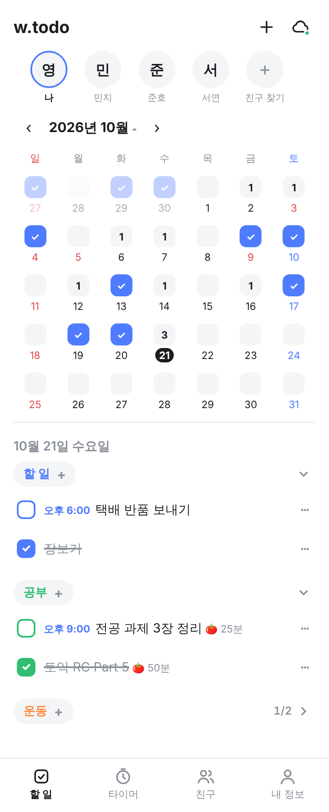
  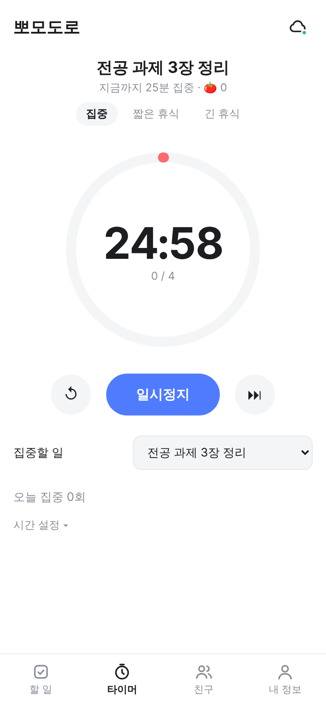
  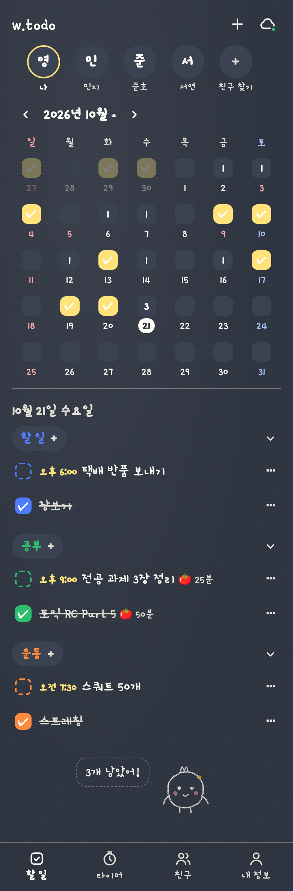
</p>

## 주요 기능

### 할 일
- 월간 달력이 첫 화면, 날짜마다 남은 할 일 수 표시 (다 끝내면 ✓)
- 한국 공휴일 표시: 일요일·공휴일 빨강, 토요일 파랑
- 카테고리별 색상, 드래그로 순서 변경
- 카테고리 접기: 접으면 `완료/전체` 개수만 표시 (예: 1/2)
- 완료한 일은 줄긋기
- 할 일마다 시간 지정 (다이얼식 선택기)
- 반복 할 일: 매일·평일·주말·요일 선택, 제목·시간을 바꾸면 이후 반복분에도 반영
- 내일 하기 / 날짜 바꾸기

| 카테고리 접기 | 할 일 상세 |
|---|---|
|  | 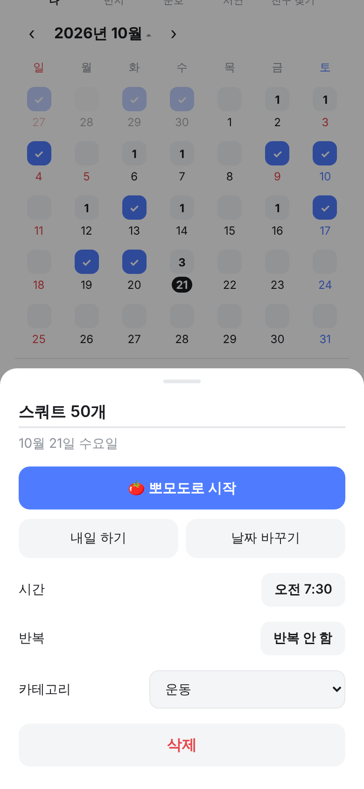 |

### 뽀모도로 타이머
- 할 일 상세에서 바로 시작
- 집중 / 짧은 휴식 / 긴 휴식 단계, 시간 직접 설정
- 끝나면 집중 시간이 그 할 일에 누적 (🍅 25분)
- 종료 시각 기준으로 계산해서 새로고침해도 이어짐
- 안드로이드 앱에서는 앱을 꺼 둬도 종료 알림

### 친구
- 상단 친구 목록: 이름을 누르면 그 친구의 달력과 할 일 보기
- 승인제 팔로우 (요청 → 수락)
- 친구가 완료한 일에 감정표현 (1인 1개)
- 카테고리 공개 범위: 팔로워 공개 / 일부 공개(선택한 팔로워만) / 나만 보기

| 친구 할 일 보기 |
|---|
| 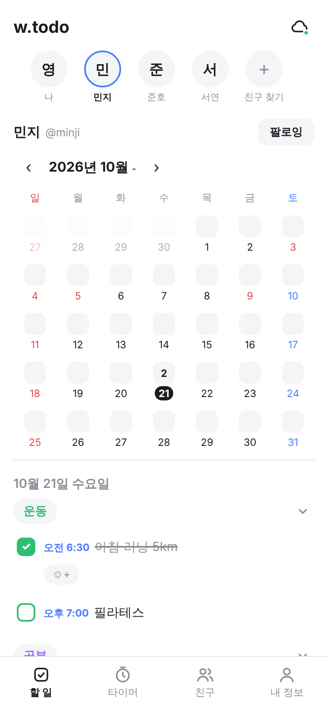 |

### 템플릿 공유
- 카테고리의 할 일·반복 루틴을 템플릿으로 묶어 공유 (노션 템플릿처럼)
- 목록에 공개 또는 링크로만 공유 선택
- 템플릿 둘러보기·검색, 사용 횟수 순 정렬
- "내 할 일에 추가"로 새 카테고리나 기존 카테고리에 바로 적용
- 공유 링크는 로그인하지 않아도 미리보기 가능

| 템플릿 목록 | 템플릿 상세 |
|---|---|
| 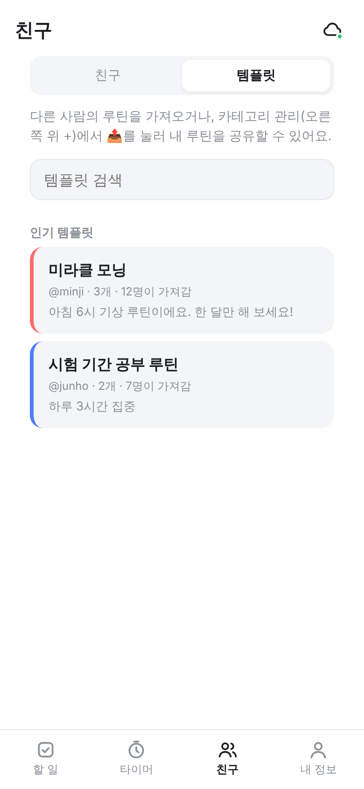 | 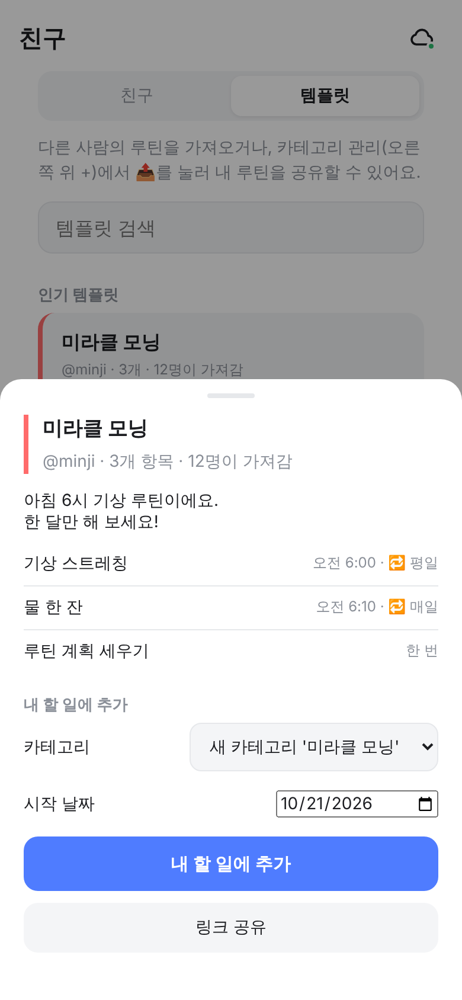 |

### 기록 (내 정보)
- 요약: 완료한 일, 이번 주 달성률, 총 집중 시간, 연속 달성일, 최근 7일
- 잔디: 1년 활동 히트맵, 카테고리별로 보기
- 집중: 요일×시간대별 집중 패턴, 가장 오래 집중한 일
- 회고: 지난달·이번 달·올해 회고 카드, 이미지로 저장·공유

| 요약 | 잔디 | 집중 | 회고 |
|---|---|---|---|
| 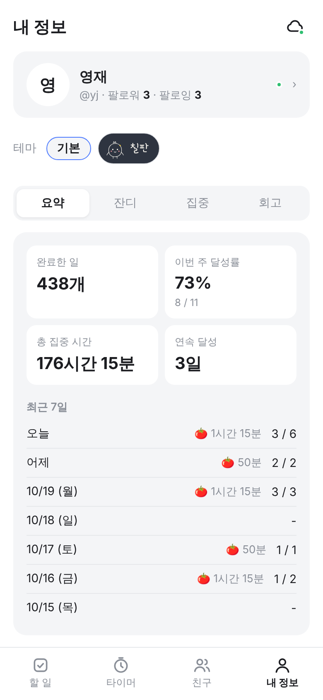 | 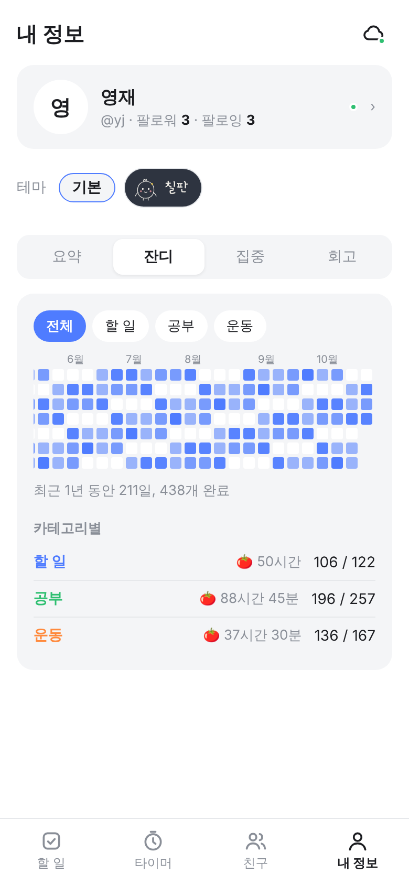 | 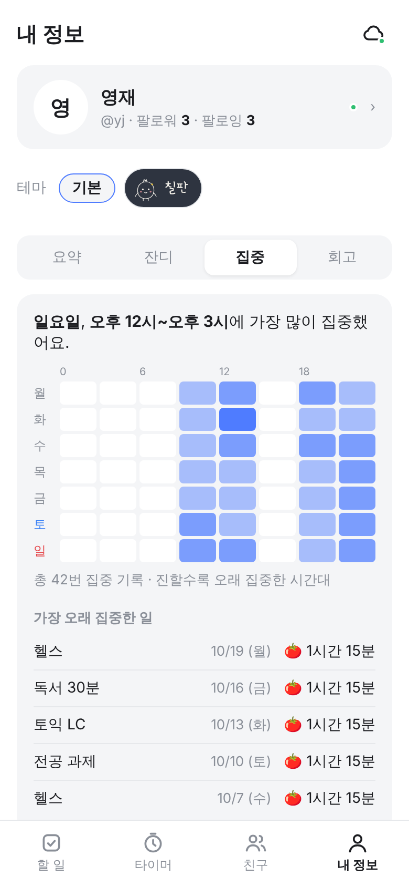 | 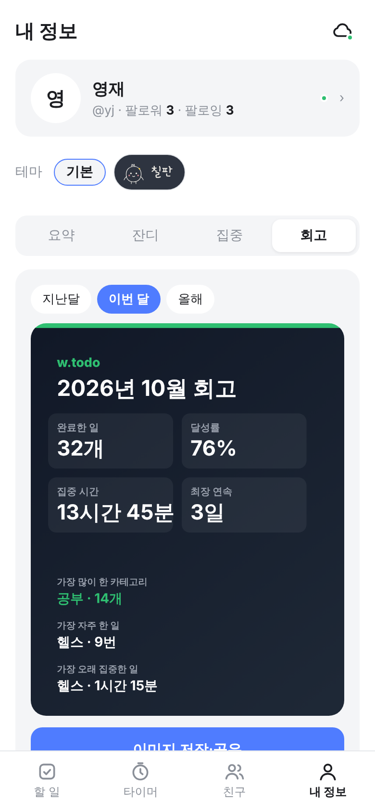 |

### 테마
- 기본 테마 (시스템 다크 모드 자동 지원)
- 칠판 테마: 남색 칠판 배경, 손글씨 폰트, 분필 질감의 캐릭터 "토도"
  - 토도가 남은 할 일 수를 말풍선으로 알려 줌 (할 일 없음: 잠, 다 끝냄: 만세)
  - 뽀모도로 중엔 머리띠를 두르고 집중
- 테마는 기기마다 따로 저장

| 칠판 테마 | 칠판 테마 뽀모도로 |
|---|---|
|  | 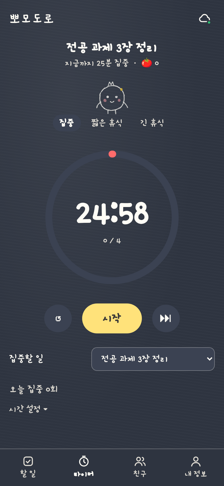 |

### 계정·동기화
- 로그인 없이도 이 기기에 저장 (오프라인 우선)
- 로그인 방법: 이메일 링크, 이메일+비밀번호, 구글, 카카오
- 로그인하면 기기 간 자동 동기화 (실시간, 마지막 수정 우선)
- 로그아웃 시 동기화를 마친 뒤 기기에 남은 데이터 삭제

## 기술 구성
- 프론트엔드: React 19, TypeScript, Vite, PWA (manifest + service worker)
- 백엔드: Supabase
  - 인증, Postgres, Realtime
  - 모든 테이블에 행 단위 보안(RLS) 적용
- 안드로이드: Capacitor 8 (웹 코드를 그대로 감싸는 방식)
- 외부 UI·달력 라이브러리 없이 직접 구현

## 실행
```bash
npm install
npm run dev        # Supabase 설정이 없으면 로컬 저장 모드로 실행
npm run build      # 타입 검사 + 빌드 (dist/)
```

## Supabase 설정
1. https://supabase.com 에서 프로젝트 생성
2. SQL Editor에 `supabase/schema.sql` 전체를 붙여넣고 실행
   - 여러 번 실행해도 안전, 스키마가 바뀌면 전체 재실행
3. `.env.example`을 참고해 `.env.local` 작성
   - `VITE_SUPABASE_URL`, `VITE_SUPABASE_ANON_KEY`
4. Authentication → URL Configuration의 Redirect URLs에 앱 주소 추가
   - 예: `http://localhost:5173`, 배포 주소, `com.wtodo.app://**` (안드로이드)
- 소셜 로그인 설정: [docs/social-login.md](docs/social-login.md)

## 배포
- Vercel에 GitHub 저장소 연결 → `main`에 푸시하면 자동 배포
- 배포 설정에 환경 변수 두 개 (`VITE_SUPABASE_URL`, `VITE_SUPABASE_ANON_KEY`) 추가

## 안드로이드 앱
- 앱 ID: `com.wtodo.app`
- Android Studio에서 빌드: `npm run android`
- 자세한 방법과 플레이스토어 등록 절차: [docs/android.md](docs/android.md)

## 폴더 구조
```
src/
  store.ts       로컬 저장소 (localStorage), 변경 추적, 반복 할 일 생성
  sync.ts        Supabase 동기화 (변경분 업로드/다운로드, 실시간 구독), 로그인·로그아웃
  social.ts      프로필, 팔로우 요청·수락, 감정표현
  templates.ts   템플릿 만들기·공유·적용
  pomodoro.ts    타이머 (종료 시각 기준)
  theme.ts       테마 (기본 / 칠판)
  native.ts      안드로이드 전용 처리 (소셜 로그인 복귀, 뒤로 가기, 알림)
  holidays.ts    한국 공휴일
  components/    화면 컴포넌트 (달력, 할 일 목록, 잔디, 회고 카드, 캐릭터 등)
supabase/schema.sql  테이블, 권한 규칙(RLS), 함수
android/             Capacitor 안드로이드 프로젝트
docs/                설정 안내서, 스크린샷
```

## 앞으로 할 일
- 안드로이드 플레이스토어 출시 (개인정보처리방침, 앱 내 계정 삭제, 비공개 테스트)
- 아이폰 앱, 애플 로그인
